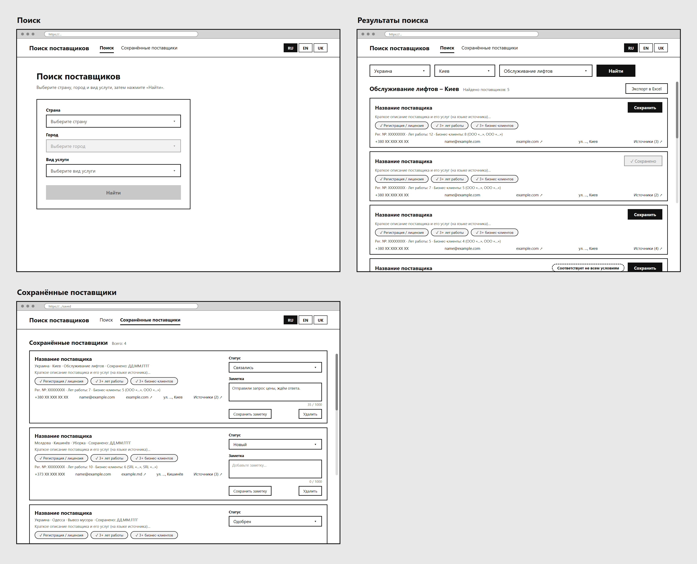
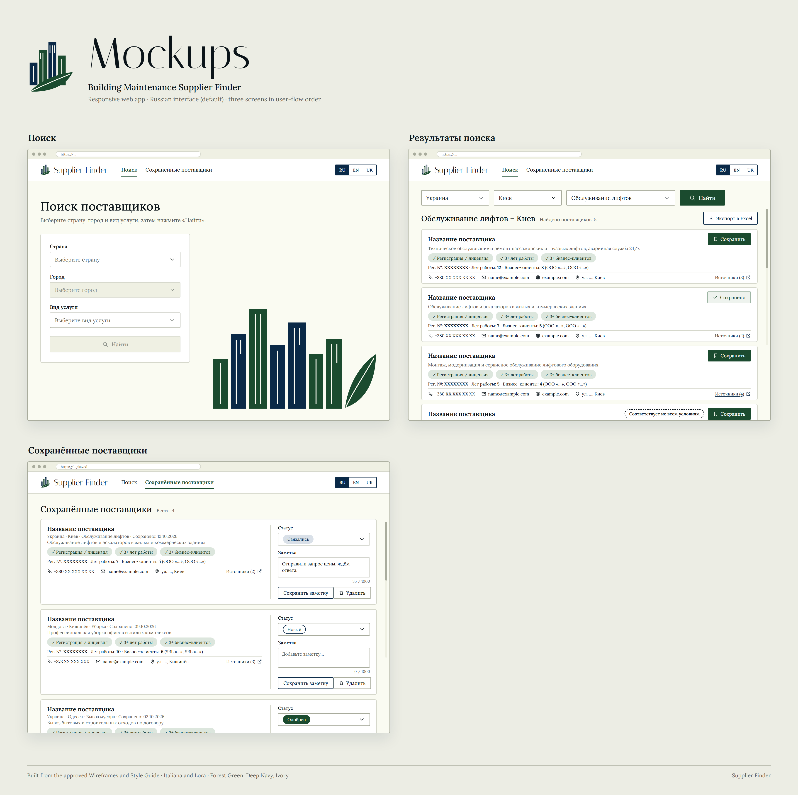
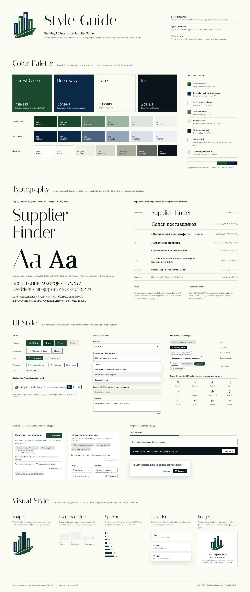

# DESIGN – אפליקציה לחיפוש ספקים לאחזקת נכסים באוקראינה ובמולדובה

> המסמך מתאר את המימוש העיצובי של המוצר. הוא מבוסס על [PRD.md](PRD.md) ועל שלוש התמונות שבתיקייה: `wireframes.png` (מבנה), `style-guide.png` (שפה עיצובית) ו-`mockups.png` (מראה סופי). דרישות המוצר, כללי ההתנהגות ומקרי הקצה מתועדים ב-PRD ולא חוזרים כאן.
>
> טקסטי הממשק מובאים ברוסית, שפת ברירת המחדל. התרגומים לאנגלית ולאוקראינית מופיעים בטבלת הטקסטים ב-PRD.

---

## 1. Screens – מסכי האפליקציה

באפליקציה יש ארבעה מסכים: Вход (התחברות), Поиск, Результаты поиска ו-Сохранённые поставщики. מסך ההתחברות לא מופיע ב-Wireframes וב-Mockups, והוא בנוי מרכיבים קיימים של ה-Style Guide (סעיף 1.0).





### רכיבים משותפים לכל המסכים

**כותרת עליונה (Header):** פס לבן (Paper ‎#FFFFFF) בגובה קבוע, עם קו תחתון דק (Line ‎#D6D8CC). הרכיבים מסודרים משמאל לימין:

| רכיב | תיאור |
|---|---|
| **Wordmark** | הסמל של המוצר (בניינים ועלה) והטקסט **Supplier Finder** בגופן Italiana. הוא נשאר באנגלית בכל שפות הממשק |
| **ניווט** | שני פריטים: **Поиск** ו-**Сохранённые поставщики**. הפריט הפעיל בצבע Forest Green ‎#1B4B2F, במשקל SemiBold, עם קו תחתון של 2px באותו צבע. הפריט השני בצבע Ink |
| **בורר שפות** | צמוד לצד ימין. שלושה כפתורים צמודים, **RU / EN / UK**, בתוך מסגרת אחת בצבע Deep Navy ‎#0A2947. השפה הפעילה ברקע Deep Navy עם טקסט Ivory, והשאר עם טקסט Deep Navy על רקע לבן |
| **משתמש** | מימין לבורר השפות: כתובת המייל של המשתמש ב-Caption ובצבע Muted (נחתכת בשלוש נקודות אם היא ארוכה), ולידה כפתור Ghost קומפקטי **Выйти**. בנייד כתובת המייל לא מוצגת, והכפתור **Выйти** עובר לשורת הניווט, מיושר לימין |

**רקע הדף:** Ivory ‎#FAFBF2. כרטיסים, שדות והכותרת העליונה בלבן (Paper).

---

### 1.0 מסך Вход (התחברות)

**מטרת המסך:** התחברות עם חשבון Google. זה המסך היחיד שמשתמש לא מחובר רואה.

**מבנה ותוכן:**
1. **כותרת עליונה מצומצמת:** ה-Wordmark ובורר השפות בלבד, בלי ניווט ובלי אזור המשתמש.
2. **כרטיס מרכזי** לבן, ממורכז אופקית במסך, ברוחב של עד 400px (ברוחב מלא בנייד), עם קו מתאר דק ופינות של 4px:
   - **הסמל של המוצר** (בניינים ועלה) בגודל בינוני, ממורכז.
   - **כותרת H1:** «Supplier Finder» ב-Italiana, ממורכזת.
   - **שורת הסבר** בטקסט משני (Muted), ממורכזת: «Войдите с аккаунтом Google, чтобы искать поставщиков и вести свой список сохранённых.»
   - **כפתור Primary ברוחב מלא של הכרטיס:** «Войти через Google», עם הסמל של Google משמאל לטקסט.
   - **שגיאת התחברות** (רק כשההתחברות נכשלה): באנר שגיאה מעל הכפתור, «Не удалось войти. Попробуйте ещё раз.».
3. **איור** הבניינים בתחתית, כמו במסך Поиск.

**פעולות וניווט:**
- «Войти через Google» מעביר לדף ההתחברות של Google. אחרי ההתחברות המשתמש חוזר לדף שביקש לפתוח, או למסך Поиск.
- בורר השפות מחליף את שפת המסך.

---

### 1.1 מסך Поиск

**מטרת המסך:** נקודת הכניסה למוצר. המשתמש בוחר מדינה, עיר ותחום שירות ומפעיל חיפוש.

**מבנה ותוכן** (מלמעלה למטה, מיושר לשמאל):
1. **הכותרת העליונה**, כשהפריט Поиск פעיל בניווט.
2. **כותרת H1:** «Поиск поставщиков».
3. **שורת הסבר** בטקסט משני (Muted ‎#5E6560): «Выберите страну, город и вид услуги, затем нажмите «Найти».»
4. **כרטיס טופס** לבן ברוחב קבוע בצד שמאל, עם קו מתאר דק ופינות של 4px. בתוכו שלושה שדות בעמודה אחת, כל אחד עם תווית מעליו:
   - **Страна:** «Выберите страну» כ-Placeholder.
   - **Город:** «Выберите город», מושבת (רקע Ivory 200 ‎#EFF0E3 וטקסט אפור) עד שבוחרים מדינה.
   - **Вид услуги:** «Выберите вид услуги».
   - **כפתור Найти** ברוחב מלא של הכרטיס, עם אייקון חיפוש. הכפתור מושבת עד ששלושת השדות מלאים.
5. **איור** בצד ימין של המסך, צמוד לתחתית: בניינים אנכיים בירוק ובכחול עם חלונות בקווי Ivory, ועלה ירוק בקצה. האיור דקורטיבי בלבד, ולכן מסומן `aria-hidden`.

**פעולות וניווט:**
- לחיצה על Найти מפעילה חיפוש ומעבירה לתצוגת Результаты поиска.
- מהניווט אפשר לעבור ל-Сохранённые поставщики.
- מבורר השפות אפשר להחליף את שפת הממשק.

---

### 1.2 מסך Результаты поиска

**מטרת המסך:** הצגת הספקים שנמצאו, עם העמידה בתנאי הסף והמקורות, כדי שהמשתמש יוכל להעריך אותם, לשמור אותם ולייצא אותם.

**מבנה ותוכן:**
1. **הכותרת העליונה**, כשהפריט Поиск פעיל.
2. **שורת חיפוש אופקית:** שלושת השדות, שמציגים את הבחירה הנוכחית (למשל Украина / Киев / Обслуживание лифтов), וכפתור **Найти** ראשי עם אייקון חיפוש. השדה של תחום השירות רחב יותר משני האחרים.
3. **כותרת התוצאות:**
   - בצד שמאל, כותרת H2 בפורמט «‹Вид услуги› – ‹Город›», ולידה כיתוב משני «Найдено поставщиков: 5».
   - בצד ימין, כפתור משני **Экспорт в Excel** עם אייקון הורדה.
   - מתחת לכותרת, שורה משנית: «Результаты поиска от ДД.ММ.ГГГГ» ב-Caption ובצבע Muted, ולידה כפתור Ghost קומפקטי **Искать заново** עם אייקון חיפוש. בנייד הכפתור עובר לשורה נפרדת מתחת לתאריך.
4. **רשימת כרטיסי ספקים** בעמודה אחת, שאפשר לגלול בה. מבנה כל כרטיס, מלמעלה למטה:
   - **שורה עליונה:** שם הספק (H3) משמאל. מימין כפתור **Сохранить** (ראשי, קטן, עם אייקון סימנייה), או **Сохранено** (מצב שמור, עם אייקון ✓, לא לחיץ).
   - **תיאור קצר** בטקסט משני, בשורה אחת שנחתכת בשלוש נקודות.
   - **שורת צ'יפים** לשלושת תנאי הסף: «Регистрация / лицензия», «3+ лет работы», «3+ бизнес-клиентов», כל אחד בסגנון לפי הסטטוס שלו (סעיף 2.3).
   - **שורת עובדות:** «Рег. №: … · Лет работы: … · Бизнес-клиенты: … (…)». הערכים בהדגשה.
   - **קו מפריד**, ומתחתיו שורת פרטי קשר עם אייקונים: טלפון, אימייל, אתר, כתובת. בקצה הימני הקישור **«Источники (N)»** עם אייקון קישור חיצוני.
   - **ספק שלא עומד בכל התנאים:** משמאל לכפתור השמירה מוצג התג «Соответствует не всем условиям».

**פעולות וניווט:**
- שינוי השדות ולחיצה על Найти מפעילים חיפוש חדש באותו מסך. תוצאה שמורה מוצגת מיד, בלי מצב הטעינה.
- Искать заново מפעיל חיפוש חדש ברשת לאותה עיר ואותו תחום, עם מצב הטעינה הרגיל.
- Сохранить שומר את הספק, והכפתור מתחלף ל-Сохранено.
- Экспорт в Excel מוריד קובץ.
- לחיצה על טלפון, אימייל, אתר או מקורות פותחת חיוג, מייל או קישור חיצוני.
- מהניווט אפשר לעבור ל-Сохранённые поставщики.

**מצבים נוספים של המסך** (לא מופיעים ב-Mockups. העיצוב שלהם מופיע ב-Style Guide):
- **חיפוש בתהליך:** הטקסט «Идёт поиск…» עם פס התקדמות ירוק. מתחת לפס מוצג השלב הנוכחי של החיפוש, ומתחתיו, בטקסט קטן ומעומעם, ההערה «Обычно это занимает до минуты.».
- **פחות מ-5 ספקים:** באנר מידע «Найдено меньше 5 поставщиков».
- **שגיאה:** באנר כהה עם «Не удалось выполнить поиск. Попробуйте ещё раз.» וכפתור «Повторить».
- **לא נמצאו ספקים:** הודעת «Поставщики не найдены». ההודעה מעוצבת כמו מצב ריק (סעיף 2.4), וכפתור הייצוא לא מוצג.

---

### 1.3 מסך Сохранённые поставщики

**מטרת המסך:** ניהול הרשימה האישית של הספקים השמורים של המשתמש המחובר, עבור עיר ותחום שירות אחד בכל פעם: צפייה, עדכון סטטוס והערה, ומחיקה.

**מבנה ותוכן:**
1. **הכותרת העליונה**, כשהפריט Сохранённые поставщики פעיל.
2. **שורת כותרת:** בצד שמאל כותרת H2 «Сохранённые поставщики», ולידה כיתוב משני «Всего: N» (מספר הספקים עבור העיר והתחום שנבחרו). בצד ימין כפתור משני **Экспорт в Excel** עם אייקון הורדה, כמו במסך התוצאות. הכפתור מוצג רק כשמוצג לפחות ספק אחד.
3. **שורת סינון:** שלושה שדות בחירה בשורה אחת, **Страна**, **Город** ו-**Вид услуги**, עם תווית מעל כל שדה, באותו סגנון של שדות החיפוש. השדה של תחום השירות רחב יותר. אין כפתור: הרשימה מתעדכנת מיד עם כל בחירה. בנייד השדות מוצגים זה מתחת לזה.
4. **רשימת כרטיסים** בעמודה אחת, עם גלילה. כל כרטיס מחולק לשני אזורים, עם קו אנכי דק ביניהם:
   - **אזור הפרטים** (רחב, משמאל):
     - שם הספק (H3).
     - שורת מטא-נתונים «Страна · Город · Вид услуги · Сохранено: ДД.ММ.ГГГГ».
     - תיאור קצר, צ'יפים של תנאי הסף ושורת עובדות.
     - פרטי קשר עם אייקונים, והקישור «Источники (N)».
   - **אזור העריכה** (צר, מימין, ברוחב קבוע):
     - **Статус:** שדה בחירה רגיל, ולידו הסטטוס הנוכחי כצ'יפ צבעוני (סעיף 2.3).
     - **Заметка:** שדה טקסט רב-שורות עם Placeholder «Добавьте заметку…», ומתחתיו מונה תווים מיושר לימין, «35 / 1000».
     - **כפתורים:** **Сохранить заметку** (משני) משמאל, ו-**Удалить** (Ghost עם אייקון פח) מימין.

**פעולות וניווט:**
- בחירת סטטוס נשמרת מיד.
- Сохранить заметку שומר את ההערה.
- שינוי מדינה, עיר או תחום בשורת הסינון מחליף את הרשימה מיד. שינוי מדינה מאפס את העיר.
- Экспорт в Excel מוריד קובץ עם הספקים של העיר והתחום שנבחרו. אם הייצוא נכשל, מוצג מתחת לשורת הסינון באנר השגיאה «Не удалось экспортировать файл. Попробуйте ещё раз.».
- Удалить פותח חלון אישור: «Удалить поставщика из списка сохранённых?», עם הכפתורים «Отмена» ו-«Удалить». העיצוב שלו מופיע ב-Style Guide.
- מהניווט אפשר לחזור ל-Поиск.

**מצבים ריקים** (לא מופיעים ב-Mockups), בעיצוב של מצב ריק (סעיף 2.4): הסמל של המוצר, ומתחתיו ההודעה.
- **לא נבחרו עיר ותחום:** «Выберите город и вид услуги».
- **אין ספקים שמורים עבור העיר והתחום שנבחרו:** «Нет сохранённых поставщиков».

---

### 1.4 מבנה הניווט הכללי

```
   Вход ──[Войти через Google]──► (Google) ──► הדף שהמשתמש ביקש, או Поиск
                                                    ▲
   [Выйти] בכותרת העליונה ──► Вход                  │
                ┌──────────── Header: Поиск | Сохранённые поставщики | RU EN UK | email [Выйти] ┐
                │                                                                            │
   Поиск  ──[Найти]──►  Результаты поиска  ──[Сохранить]──►  (ספק נוסף לרשימה)               │
     ▲                        │  ▲                                                           │
     │                        └──┘ חיפוש חדש באותו מסך                                       │
     └──────────────────────── ניווט ─────────────────────────►  Сохранённые поставщики ◄───┘
```

- הניווט הראשי מחובר תמיד לשני יעדים בלבד: **Поиск** (שמציג את הטופס או את התוצאות האחרונות) ו-**Сохранённые поставщики** (שנפתח מסונן לפי העיר והתחום שנבחרו במסך החיפוש).
- **Результаты поиска** הוא המשך של Поиск ולא פריט נפרד בניווט. לכן כשהוא מוצג, הפריט Поиск מסומן כפעיל.
- אין מסכים פנימיים נוספים. חלון אישור המחיקה הוא חלון קופץ מעל מסך Сохранённые поставщики.
- **Вход** מוצג רק למשתמש לא מחובר, ואינו חלק מהניווט. משתמש לא מחובר שפותח כל מסך אחר מועבר אליו.

---

## 2. Style Guide – השפה העיצובית



**האווירה:** שקטה, מדויקת ו"מושרשת". גופן Serif בניגודיות גבוהה על רקע שנהב, קווים דקים ושני צבעים מרכזיים: ירוק יער וכחול כהה. העלה הוא האלמנט האורגני היחיד. אין מעברי צבע (Gradients) ואין קישוט שאין לו משמעות.

### 2.1 Color Palette

**צבעי בסיס**

| שם | HEX | תפקיד |
|---|---|---|
| Forest Green | `#1B4B2F` | פעולה ראשית, סמל המוצר, ניווט פעיל, תנאי שמתקיים |
| Deep Navy | `#0A2947` | פעולה משנית, קישורים, Focus, בורר שפות |
| Ivory | `#FAFBF2` | רקע הדף |
| Ink | `#0B1419` | טקסט, תנאי שלא מתקיים, באנר שגיאה |

**סקאלות גוונים**

| | 900 | 700 (base) | 500 | 300 | 100 | 50 |
|---|---|---|---|---|---|---|
| Forest Green | `#12331F` | `#1B4B2F` | `#5A7F66` | `#9DB5A3` | `#DCE6DD` | `#EEF3EE` |
| Deep Navy | `#071D33` | `#0A2947` | `#4A6380` | `#95A6B9` | `#D9E0E8` | `#EDF1F5` |

**נייטרליים**

| שם | HEX | שימוש |
|---|---|---|
| Paper | `#FFFFFF` | כרטיסים, שדות, כותרת עליונה, תפריטים |
| Ivory | `#FAFBF2` | רקע הדף |
| Ivory 200 | `#EFF0E3` | רכיבים מושבתים, סטטוס «Не подходит» |
| Line | `#D6D8CC` | קווי מתאר של כרטיסים, קווים מפרידים |
| Line strong | `#A9AC9D` | קווי מתאר של שדות וכפתורי Ghost |
| Muted | `#5E6560` | טקסט משני, תיאורים, כיתובים |
| Ink | `#0B1419` | טקסט ראשי |

**תפקידים וניגודיות** (כולם עומדים ב-WCAG AA, ורובם ב-AAA)

| תפקיד | שילוב | ניגודיות |
|---|---|---|
| פעולה ראשית | Ivory על Forest Green | 9.6:1 |
| פעולה משנית, קישורים, Focus | Deep Navy על Ivory | 14.2:1 |
| רקע וטקסט | Ink על Ivory | 17.9:1 |
| טקסט משני | Muted על Ivory | 5.7:1 |
| תנאי מתקיים | Green 900 על Green 100 | 10.8:1 |
| תנאי לא מתקיים | Ivory על Ink | 17.9:1 |
| סטטוס של ספק שמור | Navy 700 על Navy 100 | 11.1:1 |
| לא אומת | Muted עם קו מתאר מקווקו | הסטטוס לא תלוי בצבע בלבד |

**יחס שימוש:** Ivory 58%, Green 22%, Navy 14%, Ink 6%.

### 2.2 Typography

| גופן | שימוש |
|---|---|
| **Italiana** (Regular) | Wordmark «Supplier Finder» וכותרות תצוגה באנגלית בלבד. אין לו אותיות קיריליות |
| **Lora** (400 / 500 / 600) | כל הכותרות, הטקסט והממשק ברוסית ובאוקראינית. כולל קירילית מלאה |

שני הגופנים בקוד פתוח (SIL OFL), וזמינים ב-Google Fonts.

**סולם טקסט** (Desktop, ובסוגריים Mobile)

| רמה | גופן ומשקל | גודל / Line height | דוגמה |
|---|---|---|---|
| Wordmark | Italiana | 44 / 52 בלוגו גדול. בכותרת העליונה בגודל מוקטן | Supplier Finder |
| H1 | Lora Medium | 32 / 40 (26 / 34) | Поиск поставщиков |
| H2 | Lora Medium | 24 / 32 (20 / 28) | Обслуживание лифтов – Киев |
| H3 | Lora SemiBold | 18 / 26 (17 / 24) | Название поставщика |
| H4 | Lora SemiBold | 15 / 22 | Соответствует не всем условиям |
| Body | Lora Regular | 15 / 24 | תיאור ספק |
| Interface | Lora Medium | 14 / 20 | תוויות, כפתורים, שדות, ניווט |
| Caption | Lora Regular | 12 / 16 | Источники (3) · Сохранено: 12.10.2026 |

**כללים:**
- Sentence case בכל מקום.
- טקסט מיושר לשמאל, ואורך שורה של עד 80 תווים.
- אין טקסט קטן מ-12px.
- נתוני הספקים מוצגים בשפת המקור שלהם.
- תאריכים בפורמט ДД.ММ.ГГГГ, טלפונים בפורמט בינלאומי (‎+380 / ‎+373), ומספרים בספרות.

### 2.3 UI Style

**כפתורים** (פינות של 2px, גופן Lora Medium)

| סוג | מראה | שימוש |
|---|---|---|
| Primary | רקע Forest Green, טקסט Ivory. Hover: רקע Green 900. Focus: מסגרת Deep Navy של 2px במרחק 2px | Найти, Сохранить, Войти через Google |
| Primary disabled | רקע Ivory 200, קו Line וטקסט אפור | Найти לפני שכל השדות מלאים |
| Secondary | רקע לבן, קו וטקסט Deep Navy. Hover: רקע Navy 50 | Экспорт в Excel, Сохранить заметку, Отмена, Повторить |
| Saved | רקע Green 50, קו Green 300 וטקסט Forest Green, עם ✓. לא לחיץ | Сохранено |
| Ghost | רקע לבן, קו Line strong וטקסט Ink | Удалить בכרטיס, Искать заново, Выйти |
| Destructive confirm | רקע Ink, טקסט Ivory ואייקון פח | Удалить בחלון האישור |
| Link | טקסט Deep Navy עם קו תחתון ואייקון קישור חיצוני | Источники (N) |

כפתורים עם אייקון: האייקון משמאל לטקסט. גובה רגיל 38px, וגובה קומפקטי 30px לכפתורים בתוך כרטיסים.

**שדות ותפריטים:**
- **שדה בחירה:** רקע לבן, קו Line strong, פינות 2px, גובה 40px, ואייקון חץ (Chevron) בצד ימין. התווית מעל השדה ב-Lora SemiBold.
- **Placeholder:** בצבע Muted.
- **Focus או תפריט פתוח:** קו Deep Navy של 1.5px וטבעת Navy 100 של 3px. החץ מתהפך.
- **שדה מושבת:** רקע Ivory 200 וטקסט אפור.
- **רשימה נפתחת:** הרשימה הרגילה של הדפדפן ושל מערכת ההפעלה (ARCHITECTURE.md, ADR-3). העיצוב שלמעלה חל על השדה הסגור. המראה של הרשימה הפתוחה, שמופיע ב-Style Guide (רקע Green 50 ו-✓ לאפשרות הנבחרת), לא מיושם.
- **שדה הערה:** אותו סגנון של שדה רגיל, בגובה של כמה שורות. מונה התווים מתחתיו, ב-Caption ובצבע Muted, מיושר לימין.

**צ'יפים ותגיות** (מעוגלים לגמרי, בצורת Pill)

| צ'יפ | מראה |
|---|---|
| תנאי מתקיים | ‎✓ + שם התנאי. רקע Green 100, טקסט Green 900 |
| תנאי לא מתקיים | ‎✕ + שם התנאי. רקע Ink, טקסט Ivory |
| תנאי לא אומת | ? + שם התנאי. רקע לבן, קו מקווקו וטקסט Muted |
| «Соответствует не всем условиям» | רקע לבן, קו מקווקו בצבע Ink וטקסט SemiBold |
| סטטוס «Новый» | רקע לבן, קו וטקסט Deep Navy |
| סטטוס «Связались» | רקע Navy 100, טקסט Deep Navy |
| סטטוס «Одобрен» | רקע Forest Green, טקסט Ivory |
| סטטוס «Не подходит» | רקע Ivory 200, קו Line strong וטקסט Muted |

**כרטיסים:**
- רקע לבן, קו Line של 1px ופינות של 4px. במצב רגיל אין צל, וב-Hover יש צל Raised.
- בתוך הכרטיס, שורת פרטי הקשר מופרדת בקו Line דק.
- בכרטיס של ספק שמור, אזור העריכה מופרד בקו אנכי דק.

**אייקונים:** קו בלבד, ברשת של 24px, בעובי קו של 1.75px, עם קצוות ישרים ופינות חדות. הצבע יורש את צבע הטקסט, ובדרך כלל הוא Deep Navy או Ink.

האייקונים בשימוש: חיפוש, Chevron, הורדה (ייצוא), סימנייה (שמירה), ✓, ✕, ? (לא אומת), פח (מחיקה), טלפון, מייל, קישור חיצוני, מיקום (כתובת), גלובוס (אתר) ו-i (מידע). בכפתור ההתחברות מופיע הסמל של Google, בצבעים המקוריים שלו ובלבן מאחוריו, לפי הנחיות המותג של Google. זה החריג היחיד לסגנון האייקונים.

**הודעות וחלונות:**
- **פס התקדמות:** בעובי 6px, מעוגל, עם מילוי Forest Green על רקע Line.
- **באנר מידע:** רקע לבן, קו Line strong, פס שמאלי של 3px ב-Deep Navy ואייקון i.
- **באנר שגיאה:** רקע Ink וטקסט Ivory, עם כפתור «Повторить» ברקע Ivory בצד ימין.
- **חלון אישור:** רקע לבן, פינות 4px וצל Overlay. השאלה ב-SemiBold, והכפתורים מיושרים לימין: «Отмена» (Secondary) ואחריו «Удалить» (Destructive confirm).

### 2.4 Visual Style

| מאפיין | הגדרה |
|---|---|
| **צורות** | נפחים אנכיים ומלבניים שמופרדים ברווחים דקים בצבע Ivory. העלה הוא הצורה האורגנית היחידה |
| **פינות** | 2px לשדות ולכפתורים, 4px לכרטיסים, לתפריטים ולחלונות, ועיגול מלא (Pill) לצ'יפים ולפס ההתקדמות |
| **קווי מתאר** | קווים דקים של 1px (Line או Line strong). טבעת Focus של 2px ב-Deep Navy |
| **צללים** | עומק נוצר קודם כול מקווים. הצללים בגוון כחול, רכים ונדירים: Flat (קו בלבד) לכרטיסים ולשדות. Raised ‏`0 4px 14px rgba(10,41,71,.10)` ב-Hover על כרטיס. Overlay ‏`0 12px 32px rgba(10,41,71,.14)` לתפריטים ולחלון האישור |
| **מרווחים** | יחידת בסיס של 8px, בסקאלה 4 / 8 / 12 / 16 / 24 / 32 / 48 / 64. רוחב תוכן מקסימלי של 1200px, עם שוליים של 24px ב-Desktop ו-16px ב-Mobile |
| **פריסה** | כותרת עליונה קבועה. מתחתיה תוכן בעמודה אחת: טופס או שורת חיפוש, כותרת אזור, ורשימת כרטיסים ברוחב מלא |
| **איורים** | בלוקים שטוחים בשני צבעים, ירוק וכחול, עם חלונות בקווי Ivory ועלה אחד. בלי צילומים ובלי Gradients. משמשים בסמל, במסך Поиск ובמצבים ריקים, ותמיד עם שורת טקסט קצרה |
| **מצב ריק** | כרטיס לבן ממורכז, ובו הסמל ומתחתיו הודעה ב-Lora Medium, כמו «Нет сохранённых поставщиков» |

**Mobile:** ב-Style Guide מוגדרים לנייד גדלי טקסט (סעיף 2.2) ושוליים של 16px. ה-Mockups מציגים רק Desktop, ולכן הסידור המדויק של הרכיבים בנייד לא מוגדר בהם. בהתאם לדרישת הרספונסיביות ב-PRD, בנייד הרכיבים מוצגים בעמודה אחת, באותה שפה עיצובית ועם אזורי לחיצה נוחים לאצבע.

### 2.5 שפה וכיווניות

- **שפות הממשק:** רוסית (ברירת מחדל), אנגלית ואוקראינית. בכל השפות משתמשים באותם רכיבים ובאותה פריסה, ורק הטקסט מתחלף.
- **כיווניות:** LTR בכל השפות.
- **יישור:**
  - טקסט, כותרות, תוויות ושדות מיושרים לשמאל.
  - בורר השפות, כפתורי פעולה בשורת כותרת או בראש כרטיס, הקישור «Источники» ומונה התווים מיושרים לימין.
- **גופנים לפי שפה:** טקסט בקירילית תמיד ב-Lora. Italiana משמש רק ל-Wordmark הלטיני.
- **נתוני ספקים:** מוצגים בשפת המקור, גם כשהיא שונה משפת הממשק (למשל אוקראינית או רומנית בממשק ברוסית).
